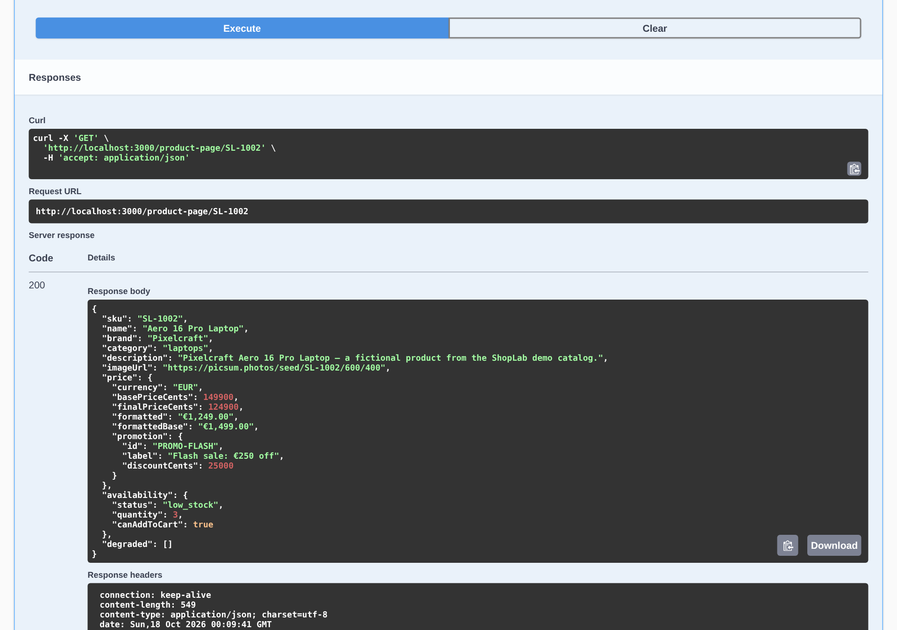
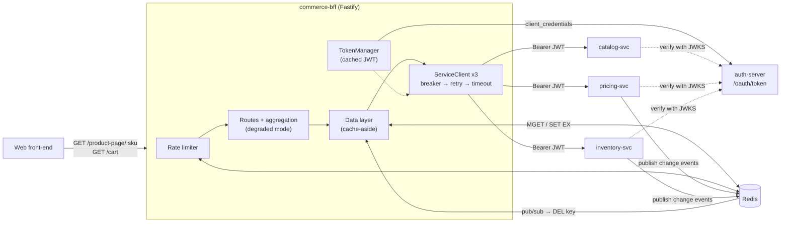
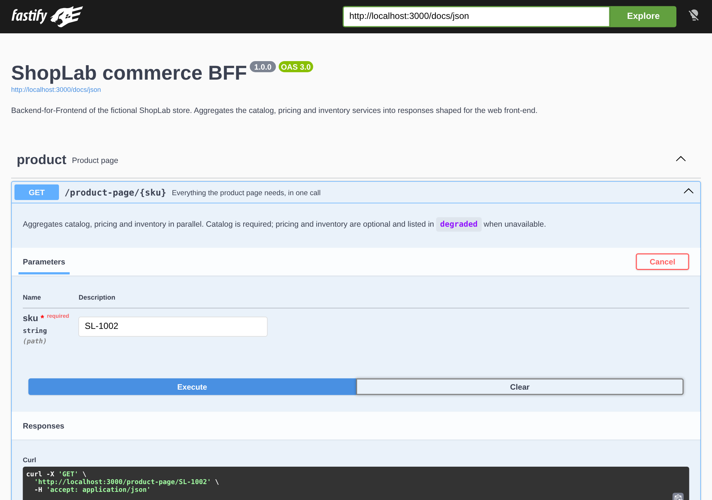

# commerce-bff

[](https://github.com/Melvin2209/commerce-bff/actions/workflows/ci.yml)


**A Backend-for-Frontend for a fictional online store (_ShopLab_), built with Node.js, TypeScript and Fastify.**
It turns three unreliable microservices (catalog, pricing, inventory) into one front-end-shaped API,
secured with OAuth2 client credentials, hardened with timeouts / retries / circuit breakers, and sped up by a Redis cache.



> Student / portfolio project. Every brand, product, price and promotion is invented.

---

## Contents

- [Architecture](#architecture)
- [Run it locally](#run-it-locally)
- [Try it](#try-it)
- [API](#api)
- [Technical choices](#technical-choices)
- [Benchmark: per-line calls vs. aggregated response](#benchmark-per-line-calls-vs-aggregated-response)
- [Tests and CI](#tests-and-ci)
- [Project structure](#project-structure)
- [Limitations and next steps](#limitations-and-next-steps)

## Architecture



| Process     | Port | Role                                                                                     |
| ----------- | ---: | ---------------------------------------------------------------------------------------- |
| `bff`       | 3000 | Public API for the front-end, Swagger UI on `/docs`                                      |
| `auth`      | 4000 | OAuth2 authorization server (client credentials grant), signs RS256 JWTs, exposes a JWKS |
| `catalog`   | 4001 | Product data (name, brand, images...)                                                    |
| `pricing`   | 4002 | Base prices + promotions → final price                                                   |
| `inventory` | 4003 | Stock levels                                                                             |
| `redis`     | 6379 | Cache, carts, rate-limit counters, change events                                         |

The three services are **simulated**: in-memory data, but real HTTP, real JWT checks, and a
configurable **chaos** layer (random latency + random 503s), so the resilience code is exercised for real.

### What happens on `GET /product-page/SL-1002`

1. The rate limiter checks the client's quota (counter in Redis).
2. The BFF asks the cache for `product:SL-1002`, `price:SL-1002` and `stock:SL-1002`.
3. For each miss, it calls the matching service **in parallel**, with a cached OAuth2 token.
   Each call: circuit breaker → 1 retry with backoff → 500 ms timeout per attempt.
4. Results are cached with a TTL per kind (product 10 min, price 60 s, stock 10 s).
5. If pricing or inventory failed, the page is still returned with `"degraded": ["inventory"]`
   and an `x-degraded` header. If the catalog failed there is nothing to show: clean `503`.

## Run it locally

### With Docker (one command)

```bash
cp .env.example .env   # optional, defaults work
docker compose up --build
```

Then open **http://localhost:3000/docs**.

### Without Docker

Requires Node.js 22 and a local Redis (`redis-server`).

```bash
npm ci
npm run dev        # starts auth, the 3 services and the BFF (tsx, TypeScript sources)
# or: npm run build && npm start   (compiled JavaScript)
```

## Try it

```bash
# Product page: catalog + price (best promotion) + availability in one call
curl -s localhost:3000/product-page/SL-1002 | jq

# Add to a cart (the response returns the cart id in x-cart-id)
curl -si -X POST localhost:3000/cart/items -H 'content-type: application/json' \
  -d '{"sku":"SL-1001","quantity":2}'

# Cart with line totals, totals and warnings already computed
curl -s localhost:3000/cart -H 'x-cart-id: <id>' | jq
```

**Break a service on purpose** (chaos endpoint of the simulated services):

```bash
# Inventory now fails 100% of the time
curl -s -X PUT localhost:4003/__chaos -H 'content-type: application/json' -d '{"errorRate":1}'

curl -s localhost:3000/product-page/SL-1006 | jq '{availability, degraded}'
# { "availability": { "status": "unknown", "quantity": null, "canAddToCart": true },
#   "degraded": ["inventory"] }

curl -s localhost:3000/health/upstreams | jq   # after 5 failures: "inventory": "OPEN"

# Repair it: the circuit lets a trial request through after 10 s, then closes again
curl -s -X PUT localhost:4003/__chaos -H 'content-type: application/json' -d '{"errorRate":0}'

# Make pricing slow instead: the BFF gives up after 2 x 500 ms and answers with price: null
curl -s -X PUT localhost:4002/__chaos -H 'content-type: application/json' \
  -d '{"latencyMinMs":1500,"latencyMaxMs":2000}'
```

> SL-1006 is used here because SL-1002 is already cached. A cached value is still served while its service is down: that is the cache doing its job.

**Watch the cache invalidation.** Get a back-office token, change a price, and the BFF shows it right away
instead of waiting for the 60 s TTL:

```bash
TOKEN=$(curl -s -u backoffice:dev-backoffice-secret localhost:4000/oauth/token \
  -d grant_type=client_credentials -d scope=pricing:write | jq -r .access_token)
curl -s -X PUT localhost:4002/prices/SL-1007 -H "authorization: Bearer $TOKEN" \
  -H 'content-type: application/json' -d '{"basePriceCents":3990}'
curl -s localhost:3000/product-page/SL-1007 | jq .price.formatted   # "€39.90"
```

## API

Full OpenAPI 3 documentation: `http://localhost:3000/docs` (JSON at `/docs/json`).
It is generated from the same TypeBox schemas that validate requests and serialize responses.

<details>
<summary>Screenshot of the Swagger UI</summary>



</details>

| Method   | Path                           | Description                                                                          |
| -------- | ------------------------------ | ------------------------------------------------------------------------------------ |
| `GET`    | `/product-page/:sku`           | Product + price view + availability, with `degraded`                                 |
| `GET`    | `/products/:sku/price`         | Price of one product (used by the "naive" benchmark scenario)                        |
| `GET`    | `/cart`                        | Aggregated cart (header `x-cart-id`). `?view=lines` returns only SKUs and quantities |
| `POST`   | `/cart/items`                  | Add `{ sku, quantity }`; creates the cart if no `x-cart-id` is sent                  |
| `DELETE` | `/cart/items/:sku`             | Remove a line                                                                        |
| `GET`    | `/health`, `/health/upstreams` | Liveness; circuit breaker states and cache hits/misses                               |

## Technical choices

### Why a BFF?

The front-end should not know there are three services, call each of them, merge their data and compute
totals. The BFF does it server-side, close to the services: one request per screen, responses shaped
for the UI (formatted prices, `canAddToCart`, warnings), and one place to apply security and resilience.

### Security: OAuth2 client credentials + JWT

- The BFF is a **machine-to-machine OAuth2 client**. It gets an access token from `/oauth/token`
  (client credentials grant, HTTP Basic client authentication, RFC 6749 §4.4).
- Tokens are **JWTs signed with RS256**. Services verify them with the **public key from the JWKS**, so the
  signing key never leaves the auth server and services share no secret. They check signature, issuer,
  audience and expiry, then the **scope** (`pricing:read` for `GET`, `pricing:write` for writes → `403` otherwise).
- The [`TokenManager`](src/bff/clients/token-manager.ts) **caches** the token and **renews it at 80 % of its
  lifetime**, so a request never leaves with a token about to expire. Renewal is **single-flight**: 100 concurrent
  requests trigger one call to the auth server, not 100. If the renewal fails while the current token is still
  valid, it keeps using it. If a service answers `401` (revoked token, key rotation), the client gets a fresh
  token and tries once more.
- Small details: constant-time secret comparison, `cache-control: no-store` on tokens, `authorization`
  headers redacted from logs.

### Resilience (written by hand, no library)

Every call to a service goes through [`ServiceClient`](src/bff/clients/service-client.ts):

```
circuit breaker ──► retry with backoff ──► one attempt (timeout + bearer token)
```

- **Timeout** (`AbortSignal.timeout`, 500 ms per attempt): a slow answer is often worse than no answer.
  With 1 retry, a dead service costs the user at most ~1 s.
- **Retry** with **exponential backoff and full jitter** ([`retry.ts`](src/bff/clients/retry.ts)), only for
  errors where retrying makes sense: timeouts, network errors, 5xx, 429. Never for a 404 or a 400.
  The jitter keeps clients from all retrying at the same moment (thundering herd).
- **Circuit breaker** ([`circuit-breaker.ts`](src/bff/clients/circuit-breaker.ts)): `CLOSED → OPEN` after 5
  consecutive failures. While `OPEN` the BFF fails fast without calling the service, which gives it time to recover.
  After 10 s, `HALF_OPEN` lets **one** trial request through. 4xx responses do not count as failures: the
  service answered, so it is healthy. The breaker wraps the retries, so one logical call counts once.
- **Degraded mode**, decided per service and per screen ([`degradation.ts`](src/bff/degradation.ts)):

  | Service down | Product page                              | Cart                                                                     |
  | ------------ | ----------------------------------------- | ------------------------------------------------------------------------ |
  | catalog      | `503` (nothing to show)                   | lines without name/image                                                 |
  | pricing      | `price: null`                             | `unitPrice: null`, **`totals: null`** (better no total than a wrong one) |
  | inventory    | `status: "unknown"`, `canAddToCart: true` | same                                                                     |

  Inventory being down does not block sales: losing orders for a stock service hiccup costs more than the
  rare item that went out of stock in between (checked again at checkout).

- **Rate limiting** with `@fastify/rate-limit`, counters stored in Redis so the limit holds across several
  BFF instances. If Redis fails, requests are let through (`skipOnError`).

### Cache: Redis cache-aside + event-based invalidation

- **One key per item** (`price:SL-1001`), not one per response. The cart reuses prices fetched by product
  pages, and invalidating a price drops one key. Batch reads use `MGET` and writes use a pipeline: one round-trip
  per batch. Only the misses go to the services, through their **batch endpoints** (`/prices?skus=a,b,c`).
- **TTL per kind of data**: product 10 min, price 60 s, stock 10 s.
- **Invalidation**: on a write, the service publishes `{ type: "price.updated", sku }` on Redis pub/sub
  and the BFF deletes the key immediately. The TTL is still there as a safety net if an event is lost.
- **The cache is never a dependency**: if Redis fails, the BFF logs and calls the services directly.

### Other choices

- **Fastify + TypeBox**: one schema gives request validation, TypeScript types and the OpenAPI documentation.
- **Money as integer cents** (`124900`), formatted only at the edge (`"€1,249.00"`): no floating point errors.
- **Structured JSON logs** (Pino) with a `service` field and an **`x-request-id` propagated** from the BFF to
  every service, so one user request can be followed across all logs. `LOG_PRETTY=true` gives readable logs locally.
- **Contracts duplicated on purpose**: the BFF declares its own types for the services' responses
  ([`upstream.ts`](src/bff/upstream.ts)) instead of importing them, as if they lived in separate repositories.

## Benchmark: per-line calls vs. aggregated response

How should the front-end display a cart? Two strategies, measured with [k6](https://k6.io) ([`bench/cart.js`](bench/cart.js)):

- **per-line**: `GET /cart?view=lines`, then **one `GET /products/:sku/price` per line**, sent in parallel
  (at most 6 connections per host, like a browser), and the front computes the totals itself.
- **aggregated**: one `GET /cart`. Line totals and totals are **already computed** in the response.

**Setup**: all processes on one 4-vCPU Linux VM (compiled JS, `LOG_LEVEL=warn`), 20 virtual users,
20 s per run, warm Redis cache, simulated service latency 10–40 ms, no injected errors.
"Cart view" = all the requests needed to render the cart once.

| Cart lines | Strategy   | HTTP requests / cart view | Cart views / s | Median (ms) | p95 (ms) | Errors |
| ---------: | ---------- | ------------------------: | -------------: | ----------: | -------: | -----: |
|          1 | per-line   |                       2.0 |           4972 |         3.0 |      7.0 |  0.00% |
|          1 | aggregated |                       1.0 |           6811 |         3.0 |      5.0 |  0.00% |
|          5 | per-line   |                       6.0 |           2254 |         8.0 |     14.0 |  0.00% |
|          5 | aggregated |                       1.0 |           4917 |         4.0 |      6.0 |  0.00% |
|         10 | per-line   |                      11.0 |           1291 |        14.0 |     22.0 |  0.00% |
|         10 | aggregated |                       1.0 |           3511 |         5.0 |      9.0 |  0.00% |
|         20 | per-line   |                      21.0 |            614 |        30.0 |     45.0 |  0.00% |
|         20 | aggregated |                       1.0 |           2624 |         7.0 |     11.0 |  0.00% |

**What the numbers say**

- With **20 lines**, the per-line strategy sends **21 requests** per cart view instead of 1.
  The aggregated cart serves **4.3× more cart views per second** (2,624 vs 614) and its median drops from
  **30 ms to 7 ms** (p95: 45 ms → 11 ms).
- The per-line cost grows **linearly with the number of lines**. Every extra request pays the full
  HTTP + routing + rate-limit + cache lookup overhead. The aggregated cost barely moves: one `MGET` for
  20 keys costs about the same as for 1.
- With **1 line** both are close: the gain comes from removing round-trips, not from a faster endpoint.
- These measurements are on localhost. On a mobile network with ~50 ms round-trip time, the per-line
  strategy needs at least 1 round-trip for the lines, then ⌈20 / 6⌉ = 4 waves of price requests
  (6 connections per host), so about **5 × 50 = 250 ms** of network alone, against **~50 ms** for one
  aggregated call. _(This is an estimate, not measured here.)_
- Computing totals in the BFF also keeps business rules (promotions, rounding, what to do when a price is
  missing) in one tested place instead of in every client (web, iOS, Android).

Reproduce: start the stack with `RATE_LIMIT_MAX=100000000 CHAOS_ERROR_RATE=0 LOG_LEVEL=warn npm start`,
then run `./bench/run.sh` (needs `k6`). Raw k6 summaries are in [`bench/results/`](bench/results).

## Tests and CI

```bash
npm test               # all tests (needs Redis on localhost:6379, or set REDIS_URL)
npm run test:unit      # pure logic, no I/O
npm run test:integration
npm run lint && npm run typecheck
```

- **Unit tests** (Vitest): circuit breaker states, retry/backoff, `TokenManager` (cache, early refresh,
  single-flight, fallback) with an injected clock, promotion rules, cart totals, chaos plugin.
- **Integration tests**: the **whole system** on random ports (auth server, three services with real JWT
  checks, BFF, real Redis). Scenarios include: aggregation, degraded mode, timeouts, circuit opening and
  recovery, token reuse, OAuth2 errors (401/403, forged token), cache hits and pub/sub invalidation,
  rate limiting, Redis cart store.
- **GitHub Actions** ([`ci.yml`](.github/workflows/ci.yml)): lint (ESLint + Prettier) → typecheck → tests
  (with a Redis service container) → build, then a job that builds the Docker image, starts the stack with
  `docker compose up --wait` and smoke-tests it.

## Project structure

```
src/
├── shared/              code used by every process
│   ├── http-app.ts      Fastify base app: JSON logs, x-request-id, /health
│   ├── chaos.ts         simulated latency / errors (+ PUT /__chaos)
│   ├── jwt-auth.ts      JWT + scope verification used by the services
│   └── events.ts        change events (cache invalidation)
├── services/            the simulated microservices
│   ├── auth/            OAuth2 authorization server
│   ├── catalog/  pricing/  inventory/
│   └── seed.ts          fake ShopLab data
└── bff/
    ├── clients/         token-manager, service-client, retry, circuit-breaker
    ├── cache/           Redis cache-aside + pub/sub invalidation
    ├── cart/            cart stores (Redis, in-memory)
    ├── routes/          product-page, cart
    ├── views.ts         pure functions building the front-end responses
    └── app.ts           wiring (swagger, rate limit, error handler)
test/unit, test/integration, bench/
```

## Limitations and next steps

Things I simplified on purpose, and what I would do next:

- **No end-user authentication**. Guest carts are identified by a random UUID. In a real setup the API
  gateway authenticates the user (OAuth2 authorization code / session) and passes the identity to the BFF.
- **Simulated services** with in-memory data, reset on restart. Only one RSA key, generated at startup:
  no key rotation (the 401 → refresh path is there for it, though).
- **Circuit breaker per process** and based on consecutive failures. With many BFF instances each one learns
  on its own. A failure-rate breaker over a sliding window is more robust under mixed traffic.
- **No stale-if-error**: when the cache has expired and the service is down, the data is missing. Keeping a
  longer-lived "last known good" copy (catalog data especially) would improve degraded responses.
- **No global deadline**: the timeout is per attempt, so the worst case is `attempts × timeout`. Passing a
  per-request deadline down to every call (as gRPC does) would bound the total time more precisely.
- **No request coalescing**: on a cold cache, N concurrent requests for the same SKU trigger N upstream calls.
- **Observability**: logs only. Next: Prometheus metrics (latency per upstream, breaker state, cache hit
  ratio) and OpenTelemetry tracing instead of hand-propagated request ids.
- **Benchmark on one machine**: client, BFF and services share the same CPUs and there is ~0 ms network
  latency between them. On a real mobile network each extra round-trip costs tens of milliseconds, so the gap
  measured here is a lower bound.

## License

MIT
